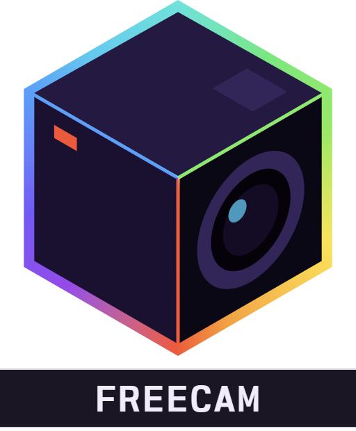

<div align="center">



# Alaydriem's Freecam

[](https://github.com/alaydriem/levi-freecam/releases)
[](https://github.com/alaydriem/levi-freecam/actions/workflows/build.yml)
[](./LICENSE)

[](https://github.com/LiteLDev/LeviLamina)

</div>

A free camera for Minecraft Bedrock, with keyframed camera paths for recording smooth shots in game (for example with OBS). Your player stays where you left it while the camera flies.

Client-side only. Nothing is sent to the server.

## Features

- Fly anywhere with smooth or instant motion, and change speed with the mouse wheel
- Player is frozen while the camera is free
- HUD, hand and crosshair are hidden (<kbd>F1</kbd> brings the HUD back)
- Camera paths: place points, play them back with easing, and lock points onto a block or entity for orbit shots
- Playback bar with rewind, play, a scrubber and point tools
- Screenshots of the freecam view, without the bar or path markers
- Turns itself off when you take damage, die, change dimension, leave the world, or the server takes the camera

## Installation

Requires the client build of [LeviLamina](https://github.com/LiteLDev/LeviLamina) and [Alaydriem's Mod Manager](https://github.com/alaydriem/levi-modmanager).

```powershell
lip install github.com/alaydriem/levi-freecam#client
```

Or download the zip from the [latest release](https://github.com/alaydriem/levi-freecam/releases/latest) and extract it into `mods/`.

| Freecam | Minecraft Bedrock | LeviLamina | Mod Manager |
| --- | --- | --- | --- |
| 0.1.0 | 1.26.51 | 26.51.6+ | 0.1.x |

## Controls

| Key | Action |
| --- | --- |
| <kbd>Ctrl</kbd> + <kbd>P</kbd> | Freecam on / off |
| <kbd>W</kbd> <kbd>A</kbd> <kbd>S</kbd> <kbd>D</kbd> | Move |
| <kbd>Space</kbd> / <kbd>Shift</kbd> | Up / down |
| Hold <kbd>Ctrl</kbd> | Move 3x faster |
| Mouse wheel | Change speed |
| <kbd>Ctrl</kbd> + <kbd>[</kbd> | Smooth motion on / off |
| <kbd>Ctrl</kbd> + <kbd>E</kbd> | Show / hide the playback bar, or stop playback |
| <kbd>Ctrl</kbd> + <kbd>B</kbd> | Add a path point |
| <kbd>Del</kbd> | Delete the selected point |
| Hold right mouse | Look around while the bar is open |

All keys can be changed on the mod manager's Keybinds page. Only the on / off key works while freecam is off.

### Playback bar

| Button | Action |
| --- | --- |
| Rewind | Jump to the start of the path |
| Play | Play from the playhead |
| Scrubber | Drag to move along the path; click a point to select it |
| Re-place | Move the selected point to the camera |
| Delete | Delete the selected point |
| Add point | Add a point at the playhead |
| Clear (✕) | Delete all points (click twice) |
| Screenshot | Save a PNG to `%USERPROFILE%\Pictures\Screenshots` |

## Configuration

Settings are in the mod manager panel and saved to `config.hcl` in the mod's config folder.

<details>
<summary>All settings</summary>

Speeds are in blocks per second.

| Section | Setting | Default | Description |
| --- | --- | --- | --- |
| `keys` | `toggle` | `"Ctrl+P"` | Freecam on / off |
| | `toggle_smooth` | `"Ctrl+LeftBracket"` | Smooth motion on / off |
| | `add_point` | `"Ctrl+B"` | Add a path point |
| | `toggle_bar` | `"Ctrl+E"` | Show / hide the bar (<kbd>Tab</kbd> is not allowed) |
| | `delete_point` | `"Delete"` | Delete the selected point |
| | `fly_forward` / `fly_back` / `fly_left` / `fly_right` | `"W"` / `"S"` / `"A"` / `"D"` | Move |
| | `fly_up` / `fly_down` | `"Space"` / `"Shift"` | Up / down |
| | `fly_fast` | `"Ctrl"` | Hold to move faster |
| `motion` | `start_speed` | `6.0` | Speed when freecam turns on |
| | `min_speed` / `max_speed` | `0.5` / `80.0` | Mouse wheel speed limits |
| | `scroll_factor` | `1.25` | Speed change per wheel step |
| | `fast_multiplier` | `3.0` | Speed multiplier for the fast key |
| | `sensitivity` | `0.15` | Mouse look, degrees per count |
| | `move_ease_rate` / `look_ease_rate` | `6.0` / `14.0` | Smoothing; higher is quicker |
| | `pitch_limit` | `89.9` | Max up / down angle |
| | `max_frame_dt` | `0.1` | Longest frame time used for motion, in seconds |
| | `smooth_at_start` | `true` | Start with smooth motion on |
| `markers` | `enabled` | `true` | Draw path points and lines in the world |
| | `max_shapes` | `4096` | Max shapes drawn (`2560`–`8192`) |
| | `max_per_send` | `400` | Max shapes sent per frame (`50`–`800`) |
| | `line_weight` | `2` | `1` or `2` |
| | `frustum_depth` | `1.2` | Camera box length in blocks (`0.3`–`5.0`) |
| `look_at` | `enabled` | `true` | Lock new points onto the block or entity under the crosshair |
| | `max_distance` | `256.0` | Look-at range in blocks (`8`–`512`) |
| `screenshot` | `folder` | `%USERPROFILE%\Pictures\Screenshots` | Screenshot folder (`config.hcl` only) |
| top level | `exit_wait_frames` | `10` | Frames before control returns to the player (min `4`) |
| | `telemetry` | `false` | Log frame timing |

Marker settings and `exit_wait_frames` apply after a restart.

</details>

## FAQ

**Can I use it on servers?** It works anywhere, but some servers don't allow freecam. Check the rules first.

**Why can't I see far away?** The camera only shows chunks the server has sent you.

**Controller support?** No, keyboard and mouse only.

## Building

Requires Windows x64, [mise](https://mise.jdx.dev), rustup, [cargo-nextest](https://nexte.st) and LLVM (`clang-cl`).

```powershell
mise trust
mise run preflight
mise run build-mod
mise run test
```

## License

BSD 3-Clause. Copyright (c) 2026 Charles R. Portwood II. See [LICENSE](./LICENSE). [Nordwand Mono](https://github.com/tywr/Nordwand-Mono) is under the SIL Open Font License 1.1.
